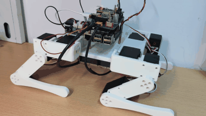
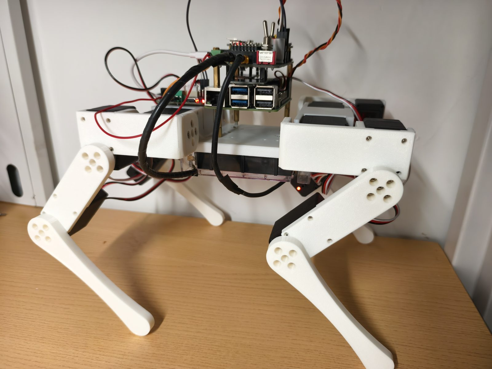
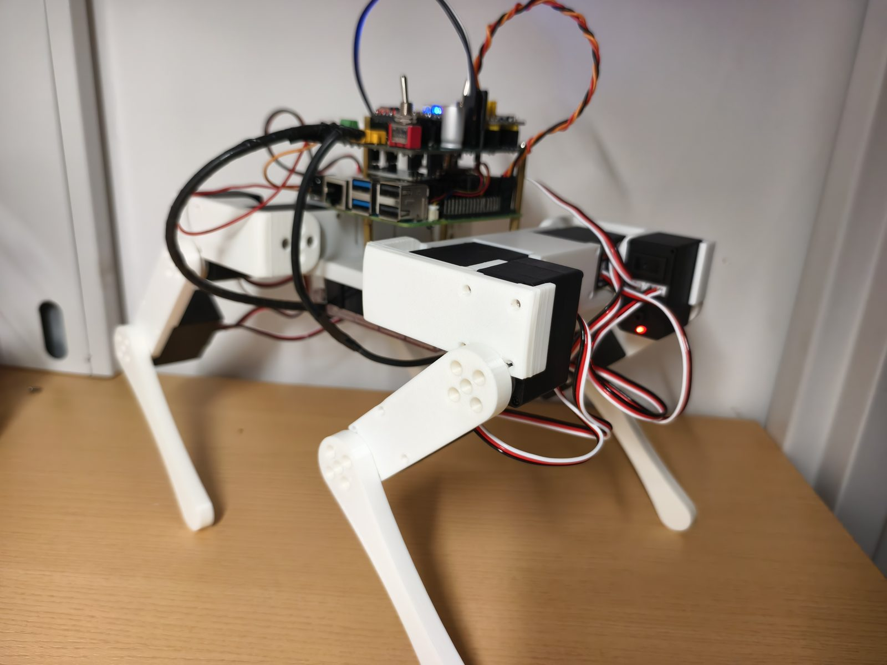
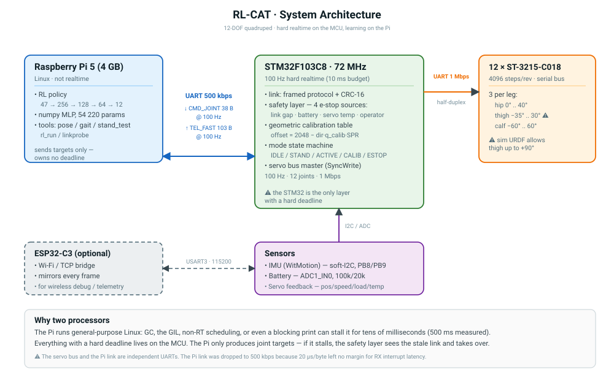
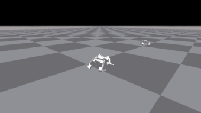

<div align="center">

# RL-CAT

**一台 12 自由度四足机器人：涵盖机械设计、电子、嵌入式固件、实时运行时与强化学习训练流程。**



[English](README.md) · [文档](docs/) · [工程记录](docs/49-progress-review.md) · [许可](LICENSE)

</div>

---

## 状态

除特别说明外，以下数据均为真机实测。

| 里程碑 | 状态 | 证据 |
|---|---|---|
| **M1 · 静态站立** | **已完成**（2026-10-18） | 保持 10 秒：位置误差 **1.23°**、漂移 **0.00°**、抖动 **0.00°**（σ）、**926 个采样中 0 个**离开 `ACTIVE` |
| M2 · 脚本步态 | 代码完成，尚未上真机 | `pi/gait.py` 为开环、仅关节空间 |
| M3 · sim-to-real 行走 | 工具链完成，尚未实现 | 观测链路已与仿真逐位一致（max\|diff\| = 0） |
| sim-to-real 差距 | **未解决** | [G1 / G2](docs/48-sim2real-gaps.md) |

### 本次发布的范围

仓库包含该机器人硬件描述、固件、上位机运行时与训练流程的完整可复现实现。
其中**尚不包含可用的行走控制器**：机器人能够站立，尚不能行走。

两项未解决的 sim-to-real 差异（关节限位不一致、驱动器延迟）连同实测依据，
记录在 [`docs/48-sim2real-gaps.md`](docs/48-sim2real-gaps.md)。

---

## 硬件

| 项目 | 规格 |
|---|---|
| 本体 | 12 自由度（单腿 3 个：外摆、髋俯仰、膝）；3D 打印结构 |
| 执行器 | 12 × Feetech ST-3215-C018 串行总线舵机，4096 步/圈 |
| 实时控制器 | STM32F103C8（Cortex-M3，72 MHz），100 Hz 控制周期 |
| 上位机 | 树莓派 5（4 GB），负责策略推理与指令生成 |
| 无线链路 | ESP32-C3，Wi-Fi/TCP 透传桥（可选） |
| IMU | WitMotion，软件 I²C |
| 电池 | 3S 锂聚合物，ADC 侧 100 kΩ / 20 kΩ 分压 |

<table>
<tr>
<td width="50%"></td>
<td width="50%"></td>
</tr>
</table>

机械 CAD 以 STEP 与 STL 两种格式发布于 [`hardware/mechanical/`](hardware/mechanical/)，
并附有实机打印所用参数。

---

## 架构



```
        ┌──────────────────────┐
        │  树莓派 5            │   RL 策略（numpy MLP，47 维观测 → 12 维动作）
        │  上位机运行时        │   工具：pose / gait / stand_test / rl_run
        └──────────┬───────────┘
                   │ UART 500 kbps，自定义帧协议，CRC-16
                   │   ↓ CMD_JOINT（38 B @ 100 Hz）    ↑ TEL_FAST（103 B @ 100 Hz）
        ┌──────────┴───────────┐
        │  STM32F103C8         │   100 Hz 实时循环
        │  - 安全层            │   - 4 条急停判据（链路 / 电池 / 温度 / 操作者）
        │  - 标定              │   - 几何标定表（不依赖 flash）
        │  - 舵机总线主站      │   - SyncWrite 至 12 个舵机 @ 1 Mbps
        └──────────┬───────────┘
                   │
        ┌──────────┴───────────┐
        │  12 × ST-3215 舵机   │
        └──────────────────────┘

        ESP32-C3 —— UART 115200 —— STM32 USART3（可选无线桥）
```

处理器划分由时序要求决定。树莓派运行通用 Linux，实测存在最高 500 ms 的调度延迟
（见 [`docs/49`](docs/49-progress-review.md) §4-A2）。因此所有具有硬时限的操作都放在
单片机上，上位机只负责产生关节目标。

### 仿真与实机的区别



上图是**仿真**画面：训练完成的策略在 Isaac Gym 平地上按不同速度指令行走，**并非真机**。

真机目前实现的是静态站立（M1，数据见上表）。两种行为之间的差异即
[`docs/48-sim2real-gaps.md`](docs/48-sim2real-gaps.md) 所讨论的内容。

---

## 快速开始

### 软件测试 —— 无需硬件，无需 Isaac Gym（约 30 秒）

```bash
cd pi
./run_checks.sh
```

依赖 Python 3.9 或以上、`numpy`、`pyserial`。CI 执行的是同一套测试。

### 固件主机单测 —— 无需硬件（约 1 分钟）

```bash
cd firmware
tools/test-host.ps1                  # Windows
bash firmware/tools/test-host.sh     # Linux / macOS
```

七套用例，共 1370 项断言。

### 策略观测链路校验（约 10 秒）

```bash
cd pi
python3 rl_policy.py --selftest
```

该命令回放一段仿真录制的轨迹，校验 47 维观测布局、各段缩放系数、关节顺序与动作映射
是否逐位一致（期望 `max|diff| = 0`）。这是仓库中最重要的一项检查：此处出现偏差会导致
动作被下发到错误的关节，而其他测试均无法发现这类问题。

---

## 仓库结构

```
docs/           25 份文档：设计、上机、验收与工程记录
firmware/
  stm32/        STM32F103 固件（Keil MDK 工程；模块可在主机上单测）
  esp32/        ESP32-C3 无线桥（PlatformIO）
  tests/host/   7 套用例 / 1370 项断言，无需硬件
  tools/        构建与测试脚本
pi/             树莓派运行时：协议、链路、标定、姿态、步态、RL 策略
  models/       导出的策略（numpy .npz、ONNX）与校验用轨迹
  tests/        离线端到端测试
hardware/
  mechanical/   STEP 与 STL 零件、打印参数、robot.urdf
  electronics/  原理图与 PCB
Sim/
  legged_gym/   训练框架分支，含 rlcat 环境
  RL/           机器人资源、训练脚本、实施报告
.github/        CI、issue 与 PR 模板、仓库卫生检查
```

---

## 设计决策

以下决策构成了本项目的主要工作量，每条均附有据以判断的依据。

| 决策 | 依据 |
|---|---|
| **三个"零位"必须区分** | URDF 零位（弯腿站姿）、标定姿态（伸直腿）与编码器零位是三个不同基准。混淆它们会导致每个关节上报 ±3.14 rad。[`docs/30`](docs/30-firmware.md) §3.3 |
| **几何标定表** | 既然标定姿态下十二个舵机均读到编码器 2048，则所有 offset 均可由常量推导。此举消除了对 flash 的依赖，也消除了"重启后偶发未标定"的故障模式。 |
| **策略侧采用 leg-major 关节顺序** | Isaac Gym 按 URDF 声明顺序排列自由度，而线协议采用 group-major 顺序。所需置换已由两项独立判据确认。 |
| **实时循环内禁止阻塞式输出** | 阻塞的 `print` 会饿死 UART，链路失效后机器人退出 `ACTIVE`。该故障在开发过程中引入并修正了四次。 |
| **`q_range` 只应用一次 `dir`** | 存储的限位本身已是关节空间量；再乘一次 `dir` 会使 `dir = -1` 的六个关节限位镜像。 |
| **舵机温度需迟滞确认** | 一次高于 70 °C 的错误读数会使全部十二个关节卸力约 87 ms，十秒内出现七次，而当时舵机实际温度为 30 °C。 |

25 项工程问题的完整清单（含根因与修正）见
[`docs/49-progress-review.md`](docs/49-progress-review.md) §4。

---

## 文档

| 目的 | 文档 |
|---|---|
| 工程记录与故障分析 | [`docs/49`](docs/49-progress-review.md) |
| sim-to-real 差距（G1 限位、G2 驱动器延迟） | [`docs/48`](docs/48-sim2real-gaps.md) |
| 上位机环境配置 | [`docs/42`](docs/42-pi-setup.md) |
| 固件调试 shell | [`docs/41`](docs/41-firmware-debug-commands.md) |
| 固件架构 | [`docs/30`](docs/30-firmware.md) |
| 训练策略 | [`docs/45`](docs/45-linux-tasks.md)、[`docs/40`](docs/40-simulation.md) |
| 完整文档索引 | [`docs/README.md`](docs/README.md) |

> 文档 `docs/33`、`34`、`35`、`36`、`37`、`38`、`39`、`50` 为 2026-10-10 的交付期快照，
> 仅作历史记录保留，不应作为现行参考；现行文档为上表所列各项。

---

## 已知限制

1. **关节限位在两种模型中不一致。** 仿真 URDF 允许 thigh 关节至 90°，而实机为 30°。
   策略指令最大达到 46.9°，因此真机运行使用 `rl_run --clamp-real` 进行夹取。
   该夹取的性能代价尚未量化。见 [`docs/48`](docs/48-sim2real-gaps.md) §G1。
2. **仿真中不存在驱动器延迟。** 实机舵机滞后 10–30 ms（一至三个控制周期），
   这是仿真中稳定的策略在真机上可能振荡的主要原因。见 §G2。
3. **仅实现静态平衡。** 机器人能够站立，行走尚未实现。
4. **上位机链路为 500 kbps 而非 1 Mbps。** 因为单字节 20 µs 对单字节 UART 接收的
   中断延迟未留出足够裕量。
5. **`pi/config.py` 中的链路阈值为开发期放宽值**（150 / 1200 ms，原 80 / 300 ms）。
   在任何安全验证之前必须恢复。
6. **机械 CAD 仅到零件级。** 装配体 STEP 尚未导出，见
   [`hardware/mechanical/README.md`](hardware/mechanical/README.md) §2。

---

## 参与贡献

见 [`CONTRIBUTING.md`](CONTRIBUTING.md)。提交 PR 前必须通过的检查：

```bash
cd pi && ./run_checks.sh
cd firmware && tools/test-host.ps1
cd pi && python3 rl_policy.py --selftest
```

---

## 许可

| 范围 | 许可 |
|---|---|
| 软件 —— 固件、上位机运行时、脚本、工具 | [Apache-2.0](LICENSE) |
| 硬件 —— CAD、PCB、URDF | [CERN-OHL-W-2.0](LICENSE-hardware) |
| 文档 —— `docs/`、`*.md` | [CC-BY-4.0](LICENSE-docs) |

第三方组件与本次发布的边界见 [`NOTICE.md`](NOTICE.md)。

**Isaac Gym 为专有软件，本仓库不包含。** 须自行向 NVIDIA 获取；缺少它无法复现训练。

---

## 安全

本平台包含锂聚合物电池、十二个可产生较大堵转电流的舵机，以及约 1.5 kg 的运动组件。

按 **Apache-2.0 §7 与 §8 以"现状"提供，不附带任何担保**。首次上电前请阅读
[`docs/46-mainline-plan.md`](docs/46-mainline-plan.md) 与
[`docs/42-pi-setup.md`](docs/42-pi-setup.md)。
